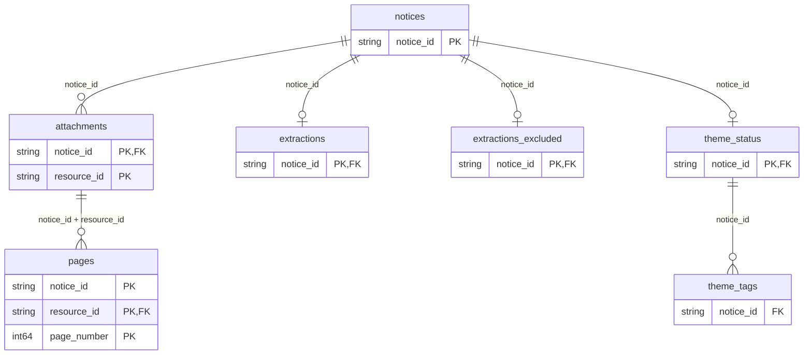

<!-- Generated by src/federal_ja/collect/data_docs.py; edit docs/tables.toml instead. -->
# Data dictionary

Generated by `src/federal_ja/collect/data_docs.py` on 2026-11-16 from Hugging Face `abigailhaddad/federal-ja-documents` at commit `14891c28`. Types, row counts, non-null shares and examples are read from the parquet files; descriptions are in `docs/tables.toml` in the GitHub repo. Columns marked **(meaning not confirmed)** are ones whose meaning the source does not define.

| table | file | Hugging Face config | rows | one row is |
|---|---|---|---|---|
| `notices` | `data/notices.parquet` | `notices` | 20,146 | One row per SAM.gov Contract Opportunities notice collected: Type starting with "Justification", or a Special Notice whose title matches the J&A pattern (`collection_reason`), posted on or after the start date. |
| `attachments` | `data/attachments.parquet` | `attachments` | 22,278 | One row per attachment listed on a notice (SAM's attachment-list endpoint), plus extra rows for additional documents fetched from one supported link. |
| `pages` | `data/pages.parquet` | `pages` | 78,677 | One row per page of a downloaded PDF or image attachment. |
| `exclusions` | `data/exclusions.parquet` | `none (not a config on the card)` | 0 | One row per row the collection rules picked from the source CSVs that is not in `notices`, with the reason. Empty when nothing was excluded. |
| `extractions` | `analysis/extractions.parquet` | `experimental_extractions` | 12,366 | EXPERIMENTAL, AI-generated (Claude Haiku). One row per notice with a document: its latest extraction record (any prompt version), or a skip record. Special Notices that don't look like a J&A, and notices the model says are not a J&A, are in `extractions_excluded` instead. |
| `extractions_excluded` | `analysis/extractions_excluded.parquet` | `none (not a config on the card)` | 560 | EXPERIMENTAL. One row per notice left out of `extractions` on purpose, with the reason and its latest record, so later runs don't extract it again. |
| `theme_status` | `analysis/theme_status.parquet` | `experimental_theme_status` | 10,504 | EXPERIMENTAL, AI-generated. One row per notice in the 2026-10-18 theme snapshot: whether it was reviewed and its result for each of the three themes. Not refreshed; notices collected later have no row. |
| `theme_tags` | `analysis/theme_tags.parquet` | `experimental_theme_tags` | 1,983 | EXPERIMENTAL, AI-generated. One row per tagged passage in the 2026-10-18 theme snapshot. A tag is a possible issue for a person to check against the document, not a finding. |

## How the tables join

- `notices.notice_id` to `attachments.notice_id`: Exact join. Some notices list no attachments.
- `attachments.resource_id` to `pages.resource_id`: Exact join on both `notice_id` and `resource_id` (the same resource can be on several notices). `sha256` identifies the exact file.
- `notices.notice_id` to `extractions.notice_id`: Exact join, at most one extraction per notice.
- `notices.notice_id` to `extractions_excluded.notice_id`: Exact join. A notice is in `extractions` or `extractions_excluded`, never both.
- `notices.notice_id` to `theme_status.notice_id`: Exact join; only notices in the 2026-10-18 snapshot.
- `theme_status.notice_id` to `theme_tags.notice_id`: Exact join; `<theme>_tags` counts the rows per theme.

## `notices` (`data/notices.parquet`, config `notices`)

One row per SAM.gov Contract Opportunities notice collected: Type starting with "Justification", or a Special Notice whose title matches the J&A pattern (`collection_reason`), posted on or after the start date.

Non-null and non-blank are shares of the table's rows; non-blank also leaves out empty strings.

| column | type | description | non-null | non-blank | example |
|---|---|---|---|---|---|
| `notice_id` | string | SAM's NoticeId. Primary key. | 100.0% | 100.0% | `00004f635ef14a73a2da2e08cd8426fb` |
| `sam_link` | string | The notice's public page, `https://sam.gov/opp/<notice_id>/view`. | 100.0% | 100.0% | `https://sam.gov/opp/00004f635ef14a73a2da2e08cd8426fb/view` |
| `title` | string | SAM CSV `Title`. | 100.0% | 100.0% | `58--BRIDGE,NIGHT VISION` |
| `solicitation_number` | string | SAM CSV `Sol#`. | 100.0% | 93.3% | `SPE4A725R039` |
| `agency` | string | SAM CSV `Department/Ind.Agency`. | 100.0% | 100.0% | `DEPT OF DEFENSE` |
| `cgac` | string | SAM CSV `CGAC`, as given (an agency code). **(meaning not confirmed)** | 100.0% | 100.0% | `097` |
| `sub_tier` | string | SAM CSV `Sub-Tier`. | 100.0% | 98.6% | `DEFENSE LOGISTICS AGENCY` |
| `fpds_code` | string | SAM CSV `FPDS Code`, as given. **(meaning not confirmed)** | 100.0% | 100.0% | `97AS` |
| `office` | string | SAM CSV `Office`. | 100.0% | 100.0% | `DLA AVIATION` |
| `aac_code` | string | SAM CSV `AAC Code`, as given. **(meaning not confirmed)** | 100.0% | 92.9% | `SPE4A7` |
| `posted_date` | string | SAM CSV `PostedDate`, as given (e.g. `2026-10-15 15:03:33`). Rows with an unparseable date go to `exclusions`. | 100.0% | 100.0% | `2025-12-10 10:39:04` |
| `type` | string | SAM CSV `Type`, as the posting office set it: `Justification` (or `Justification and Approval (J&A)`) or `Special Notice`. | 100.0% | 100.0% | `Justification` |
| `collection_reason` | string | Why the notice is here: `justification_type` (its Type starts with "Justification") or `special_notice_title_match` (a Special Notice whose title matches the J&A pattern in the card; a candidate only). | 100.0% | 100.0% | `justification_type` |
| `base_type` | string | SAM CSV `BaseType`, as given. **(meaning not confirmed)** | 100.0% | 100.0% | `Award Notice` |
| `archive_type` | string | SAM CSV `ArchiveType`, as given (e.g. `auto15`, `auto30`, `autocustom`, `manual`). **(meaning not confirmed)** | 100.0% | 100.0% | `auto30` |
| `archive_date` | string | SAM CSV `ArchiveDate`, as given. **(meaning not confirmed)** | 100.0% | 100.0% | `2026-01-09` |
| `naics_code` | string | SAM CSV `NaicsCode`: the NAICS code on the notice. | 100.0% | 92.1% | `334511` |
| `classification_code` | string | SAM CSV `ClassificationCode`, as given. **(meaning not confirmed)** | 100.0% | 94.5% | `5855` |
| `active` | string | SAM CSV `Active`: `Yes` or `No`. **(meaning not confirmed)** | 100.0% | 100.0% | `No` |
| `award_number` | string | SAM CSV `AwardNumber`, typed by the posting office. For a J&A for one order it is often the vehicle, not the order (see `sam_award_order_number`). | 100.0% | 54.2% | `SPE4A726D0099` |
| `award_date` | string | SAM CSV `AwardDate`. | 100.0% | 53.8% | `2025-12-08` |
| `award_amount` | string | SAM CSV `Award$`, as text. | 100.0% | 2.8% | `5841.18000000` |
| `awardee` | string | SAM CSV `Awardee`, as given (name with city and ZIP run together). | 100.0% | 2.9% | `RM GENERAL CONSTRUCTION MARTINEZ 94553` |
| `description` | string | SAM CSV `Description`. | 100.0% | 91.9% | `SPE4A725R0398_Redacted` |
| `csv_link` | string | SAM CSV `Link`: the logged-in workspace view, not the public page (use `sam_link`). | 100.0% | 100.0% | `https://sam.gov/workspace/contract/opp/00004f635ef14a73a2da2...` |
| `source_file` | string | The source CSV the kept row came from (the daily active file `ContractOpportunitiesFullCSV.csv` or a yearly `FY<YYYY>_archived_opportunities.csv`). When a notice is in several files, the row with the latest PostedDate is kept; ties go to the active file, then the newest archive. | 100.0% | 100.0% | `FY2026_archived_opportunities.csv` |
| `source_files` | list<element: string> | Every source CSV the notice was seen in. | 100.0% | 100.0% | `['FY2026_archived_opportunities.csv']` |
| `row_fingerprint` | string | SHA-1 of the row's Title, Sol#, PostedDate, Type, BaseType, ArchiveType, ArchiveDate, AwardNumber and Description. A change means the notice was edited on SAM and its attachment list is re-checked. | 100.0% | 100.0% | `ef5deaefd621ec2cd69865ffcaa007e67367963a` |
| `first_seen_at` | string | When the collector first saw the notice (UTC). | 100.0% | 100.0% | `2026-10-16T12:24:02+00:00` |
| `resources_status` | string | Result of reading the notice's attachment list: `ok`, `no_attachments`, `error: ...` (e.g. `error: resources 404`) or `pending`. | 100.0% | 100.0% | `ok` |
| `resources_checked_at` | string | When the attachment list was last read (UTC). | 100.0% | 100.0% | `2026-10-16T17:39:44+00:00` |
| `attachment_count` | int64 | Number of attachments the list returned. | 99.5% | 99.5% | `1` |
| `sam_award_status` | string | Result of reading SAM's notice record (`/opps/v2/opportunities/<notice_id>`): `ok` (award block read), `no_award` (record read, no award block), `not_found` (404), `error: ...`, `pending`; empty: not fetched yet. | 100.0% | 100.0% | `ok` |
| `sam_award_checked_at` | string | When the notice record was read (UTC). | 100.0% | 100.0% | `2026-10-28T14:04:33+00:00` |
| `sam_award_number` | string | `award.number` from the notice record, as typed (normally the same as `award_number`). | 54.0% | 54.0% | `SPE4A726D0099` |
| `sam_award_order_number` | string | `award.deliveryOrderNumber`: the order the J&A is for, when it is for an order. Free text, not validated. | 15.8% | 15.8% | `89303325FEM400452` |
| `sam_award_date` | string | `award.date` from the notice record. | 53.5% | 53.5% | `2025-12-08` |
| `sam_award_amount` | string | `award.amount` from the notice record, as text. | 2.8% | 2.8% | `5841.18000000` |
| `sam_awardee_name` | string | `award.awardee.name` from the notice record (often empty on J&As). | 2.8% | 2.8% | `RM GENERAL CONSTRUCTION` |
| `sam_awardee_uei` | string | `award.awardee.ueiSAM` from the notice record. | 2.8% | 2.8% | `KZC4AND1SMM5` |
| `sam_award_modification_number` | string | `award.justificationAuthority.modificationNumber` from the notice record. | 8.4% | 8.4% | `11` |
| `sam_justification_authority` | string | `award.justificationAuthority.authority`: SAM's code for the authority selected on the form (e.g. `far1`, `far13`, `2`), as stored, not normalised. SAM does not publish what each code means; the card lists the values with counts. | 54.0% | 54.0% | `far1` |
| `sam_organization_id` | string | `data2.organizationId`: the posting office's SAM Federal Hierarchy key. | 99.5% | 99.5% | `500041791` |
| `usaspending_matched` | bool | True if exactly one USAspending award was matched on `award_number`. | 100.0% | 100.0% | `True` |
| `usaspending_match_method` | string | How the match was made: `exact`, `exact+agency`, `without_modification_number`, `without_modification_number+agency`, `ambiguous`, `piid_not_found`, `no_piid` or `multiple_award_numbers` (meanings in the card). | 100.0% | 100.0% | `exact` |
| `usaspending_match_note` | string | For `ambiguous`: the candidate award keys; for `piid_not_found`: whether the number looks like a solicitation number; for a match at another agency: says so. | 5.5% | 5.5% | `looks like a solicitation number (R, Q or B in the 9th chara...` |
| `usaspending_candidates` | int64 | Number of USAspending awards with this PIID. | 100.0% | 100.0% | `1` |
| `usaspending_award_key` | string | USAspending `contract_award_unique_key` of the matched award. | 44.9% | 44.9% | `CONT_IDV_SPE4A726D0099_9700` |
| `usaspending_permalink` | string | The matched award's page on usaspending.gov. | 44.9% | 44.9% | `https://www.usaspending.gov/award/CONT_IDV_SPE4A726D0099_970...` |
| `usaspending_award_or_idv` | string | `AWARD` or `IDV`. | 44.9% | 44.9% | `IDV` |
| `usaspending_award_type` | string | USAspending's award type, e.g. `DEFINITIVE CONTRACT`, `DELIVERY ORDER`, `IDC`, `BPA`. | 44.9% | 44.9% | `IDC` |
| `usaspending_piid` | string | The matched `award_id_piid` as USAspending writes it. | 44.9% | 44.9% | `SPE4A726D0099` |
| `usaspending_parent_award_piid` | string | For an order: the PIID of the IDV it was placed under. | 4.1% | 4.1% | `SPE4A125G0020` |
| `usaspending_recipient_name` | string | The vendor, from the latest transaction. | 44.9% | 44.9% | `ELBIT SYSTEMS OF AMERICA - NIGHT VISION LLC` |
| `usaspending_recipient_uei` | string | The vendor's UEI, from the latest transaction. | 44.9% | 44.9% | `MYE5L662RU13` |
| `usaspending_recipient_parent_name` | string | The vendor's parent company. | 44.9% | 44.9% | `ELBIT SYSTEMS OF AMERICA - NIGHT VISION LLC` |
| `usaspending_awarding_agency` | string | USAspending's awarding agency. | 44.9% | 44.9% | `Department of Defense` |
| `usaspending_awarding_sub_agency` | string | USAspending's awarding sub-agency. | 44.9% | 44.9% | `Defense Logistics Agency` |
| `usaspending_awarding_office` | string | USAspending's awarding office. | 44.9% | 44.9% | `DLA AVIATION` |
| `usaspending_same_agency` | bool | Whether USAspending's awarding agency is the notice's agency, by agency code (Army, Navy and Air Force count as Defense) or name. False is common when an agency orders under another agency's contract. Null when USAspending gives no agency. | 44.9% | 44.9% | `True` |
| `usaspending_total_obligated` | float64 | Sum of `federal_action_obligation` over the matched award's transactions in the fiscal years read, US dollars: money obligated so far, not the J&A's estimated value. Can be negative. | 44.9% | 44.9% | `0.0` |
| `usaspending_transactions` | int64 | Number of transactions summed. | 44.9% | 44.9% | `2` |
| `usaspending_current_total_value` | float64 | USAspending's award-level base and exercised options value, from the latest transaction. | 24.5% | 24.5% | `751333.53` |
| `usaspending_potential_total_value` | float64 | USAspending's award-level base and all options value, from the latest transaction. | 44.9% | 44.9% | `4748541.2` |
| `usaspending_first_action_date` | string | Earliest `action_date` of the matched award's transactions. | 44.9% | 44.9% | `2025-12-08` |
| `usaspending_latest_action_date` | string | Latest `action_date`. | 44.9% | 44.9% | `2026-07-21` |
| `usaspending_extent_competed` | string | Extent competed, as reported on the latest transaction. | 42.9% | 42.9% | `NOT COMPETED` |
| `usaspending_other_than_full_and_open` | string | The exception to full and open competition cited on the latest transaction. | 23.3% | 23.3% | `ONLY ONE SOURCE-OTHER (FAR 6.302-1 OTHER)` |
| `usaspending_idv_orders` | int64 | IDVs only: number of orders whose parent is this IDV, from all ordering agencies. | 20.4% | 20.4% | `2` |
| `usaspending_idv_orders_obligated` | float64 | IDVs only: summed obligations of those orders. | 20.4% | 20.4% | `1619755.43` |
| `usaspending_as_of` | string | Latest `last_modified_date` in the USAspending files read: how current the USAspending columns are. | 100.0% | 100.0% | `2026-11-05` |

## `attachments` (`data/attachments.parquet`, config `attachments`)

One row per attachment listed on a notice (SAM's attachment-list endpoint), plus extra rows for additional documents fetched from one supported link.

Non-null and non-blank are shares of the table's rows; non-blank also leaves out empty strings.

| column | type | description | non-null | non-blank | example |
|---|---|---|---|---|---|
| `notice_id` | string | The notice (`notices.notice_id`). Part of the primary key (notice_id, resource_id). | 100.0% | 100.0% | `00004f635ef14a73a2da2e08cd8426fb` |
| `agency` | string | Copy of `notices.agency`, added when the tables are published. | 100.0% | 100.0% | `DEPT OF DEFENSE` |
| `sub_tier` | string | Copy of `notices.sub_tier`. | 100.0% | 98.9% | `DEFENSE LOGISTICS AGENCY` |
| `office` | string | Copy of `notices.office`. | 100.0% | 100.0% | `DLA AVIATION` |
| `notice_title` | string | Copy of `notices.title`. | 100.0% | 100.0% | `58--BRIDGE,NIGHT VISION` |
| `posted_date` | string | Copy of `notices.posted_date`. | 100.0% | 100.0% | `2025-12-10 10:39:04` |
| `notice_type` | string | Copy of `notices.type`. | 100.0% | 100.0% | `Justification` |
| `award_number` | string | Copy of `notices.award_number`. | 100.0% | 53.8% | `SPE4A726D0099` |
| `sam_link` | string | Copy of `notices.sam_link`. | 100.0% | 100.0% | `https://sam.gov/opp/00004f635ef14a73a2da2e08cd8426fb/view` |
| `resource_id` | string | SAM's `resourceId` for the attachment. For an extra document fetched from one link: `<link resource_id>-<n>`. Not unique on its own: the same resource can be listed on several notices. Part of the primary key (notice_id, resource_id). | 100.0% | 100.0% | `e169b2b16d624ecb86d38f844eb1159d` |
| `attachment_id` | string | SAM's `attachmentId`. Empty on extra documents from a link. | 100.0% | 100.0% | `90176760c42746a4a172ce9e02facd53` |
| `attachment_order` | int64 | SAM's `attachmentOrder`: the attachment's position on the notice. | 100.0% | 100.0% | `1` |
| `resource_type` | string | SAM's `type`, lower-cased: `file` or `link`. | 100.0% | 100.0% | `file` |
| `filename` | string | SAM's `name` for a file (or a link's description); for a fetched link, the downloaded document's name. | 100.0% | 100.0% | `SPE4A725R0398_Redacted.pdf` |
| `link_url` | string | For a link: the URL (`uri`). Empty for files. | 100.0% | 12.5% | `https://www.neco.navy.mil/synopsis_file/SPRPA126FE207_N00383...` |
| `mime_type` | string | SAM's `mimeType` (e.g. `.pdf`). | 100.0% | 87.5% | `.pdf` |
| `size` | int64 | SAM's declared `size` in bytes (0 for links). `downloaded_size` is what was received. | 100.0% | 100.0% | `577332` |
| `access_level` | string | SAM's `accessLevel`: `public` or `private`. Only public files are downloaded. | 100.0% | 100.0% | `public` |
| `access_status` | string | SAM's `accessStatus`, as given (`public` or `controlled`). **(meaning not confirmed)** | 100.0% | 100.0% | `public` |
| `export_controlled` | string | SAM's `exportControlled`, as given (as text). **(meaning not confirmed)** | 100.0% | 99.8% | `0` |
| `file_exists` | string | SAM's `fileExists`, as given (as text). **(meaning not confirmed)** | 100.0% | 100.0% | `1` |
| `deleted_flag` | bool | SAM's `deletedFlag` is `1`. Deleted files are not downloaded. | 100.0% | 100.0% | `False` |
| `deleted_date` | string | SAM's `deletedDate`. | 100.0% | 1.9% | `2025-08-01T13:17:33.423+00:00` |
| `effective_deleted_date` | string | SAM's `effectiveDeletedDate`. Seen with deletedFlag 0 on files whose download then failed with "The resource has been deleted", so these are treated as deleted. | 100.0% | 2.5% | `2025-08-01T13:17:33.423+00:00` |
| `sam_posted_date` | string | SAM's `postedDate` for the attachment, as given. **(meaning not confirmed)** | 100.0% | 100.0% | `2025-12-10T15:39:04.045+00:00` |
| `in_latest_listing` | bool | True if the attachment was in the notice's attachment list the last time it was read; an attachment SAM later drops stays with False. | 100.0% | 100.0% | `True` |
| `download_status` | string | `ok`, `link` (a link not fetched), `link_error`, `not_public`, `deleted`, `deleted_at_download`, `too_large`, `error`, `pending` or `unsupported_type` (meanings in the card). | 100.0% | 100.0% | `ok` |
| `download_error` | string | The error for a failed download or link fetch. | 84.7% | 0.4% | `LinkFetchError: piee: no attachments listed on the notice pa...` |
| `downloaded_at` | string | When the file was downloaded (UTC). | 84.2% | 84.2% | `2026-10-16T13:45:31+00:00` |
| `downloaded_size` | int64 | Bytes received. | 84.2% | 84.2% | `577332` |
| `sha256` | string | SHA-256 of the bytes received. | 84.2% | 84.2% | `248f9c4c3fccd470430c764d83b8d3f573d7ad3d7bb36937f0dd626a16e1...` |
| `file_path` | string | Path of the original file in this dataset: `files/<notice_id>/<resource_id>_<safe filename>`. | 84.2% | 84.2% | `files/00004f635ef14a73a2da2e08cd8426fb/e169b2b16d624ecb86d38...` |
| `file_kind` | string | Kind of file the text extractor saw: `pdf`, `docx`, `xlsx`, `text`, `image`, `zip`, `ole` or `other`. Native text is read from `pdf`, `docx`, `xlsx` and `text` files; `pdf` and `image` pages can be transcribed. | 84.2% | 84.2% | `pdf` |
| `page_count` | int64 | PDF pages (1 for an image). Empty for other kinds. | 69.7% | 69.7% | `4` |
| `pages_with_text` | int64 | PDF pages whose text layer counts as text (not listed in `textless_pages`). | 69.7% | 69.7% | `0` |
| `textless_pages` | list<element: int64> | Page numbers whose text layer has fewer than 300 characters (whitespace stripped) or is font-encoding garbage; these are the pages sent for transcription. | 82.6% | 82.6% | `[1, 2, 3, 4]` |
| `native_text_chars` | int64 | Characters of text read from the file itself (PDF text layer, docx, xlsx, text), before any transcription. | 84.2% | 84.2% | `0` |
| `needs_transcription` | bool | True if any page is image-only (`textless_pages` not empty), or for an image file. An XFA form never needs it. | 84.2% | 84.2% | `True` |
| `text` | string | Whole-document text: native text, with transcriptions for image-only pages. PDF text has `--- page N ---` markers. | 100.0% | 83.5% | `--- page 1 --- CUI  JUSTIFICATION FOR OTHER THAN FULL AND OP...` |
| `text_source` | string | Where `text` came from: `pdf_text`, `pdf_xfa`, `docx`, `xlsx`, `text`, `transcription`, `pdf_text+transcription` or `none` (table in the card). | 100.0% | 100.0% | `transcription` |
| `extract_error` | string | Error from text extraction, if any. | 84.2% | 0.0% | `pypdf: PdfStreamError: Stream has ended unexpectedly` |
| `transcription_model` | string | Model that transcribed image-only pages (e.g. `claude-haiku-5-5`). | 42.8% | 42.8% | `claude-haiku-5-5` |
| `transcription_prompt_version` | string | Version of the transcription prompt. | 42.8% | 42.8% | `v1` |
| `transcription_input_tokens` | int64 | Input tokens used for this file's transcriptions, summed over runs. | 42.8% | 42.8% | `15134` |
| `transcription_output_tokens` | int64 | Output tokens used, summed over runs. | 42.8% | 42.8% | `8107` |
| `transcription_cost_usd` | float64 | Cost of this file's transcriptions in US dollars, summed over runs. | 42.8% | 42.8% | `0.005567` |
| `transcribed_pages` | list<element: int64> | Page numbers whose text is a transcription. | 42.8% | 42.8% | `[1, 2, 3, 4]` |
| `transcribed_at` | string | When the file was last transcribed (UTC). | 42.8% | 42.8% | `2026-10-16T21:17:26+00:00` |
| `transcription_error` | string | Error from the last transcription, e.g. `refusal`; empty when it succeeded. | 42.8% | 0.1% | `refusal` |
| `uploaded_at` | string | When the file was committed to this dataset (UTC). | 84.2% | 84.2% | `2026-10-16T16:46:36+00:00` |
| `uploaded_commit` | string | The Hugging Face commit that added the file. | 45.4% | 45.4% | `24657a83d81a524bf4a8b32e0fb71648e3b9c08c` |
| `local_copy` | bool | Whether the collector kept a local copy after uploading (a workflow detail). | 45.4% | 45.4% | `False` |
| `source_host` | string | Host the document came from: `sam.gov` for SAM files, or the link's host (`www.neco.navy.mil`, `piee.eb.mil`). | 89.5% | 89.5% | `sam.gov` |
| `parent_resource_id` | string | For an extra document from one link: the link's `resource_id`. | 0.0% | 0.0% |  |
| `link_documents` | int64 | For a fetched link: how many documents the link held. | 1.8% | 1.8% | `1` |

## `pages` (`data/pages.parquet`, config `pages`)

One row per page of a downloaded PDF or image attachment.

Non-null and non-blank are shares of the table's rows; non-blank also leaves out empty strings.

| column | type | description | non-null | non-blank | example |
|---|---|---|---|---|---|
| `notice_id` | string | The notice (`notices.notice_id`). Part of the primary key (notice_id, resource_id, page_number). | 100.0% | 100.0% | `00004f635ef14a73a2da2e08cd8426fb` |
| `agency` | string | Copy of `notices.agency`, added when the tables are published. | 100.0% | 100.0% | `DEPT OF DEFENSE` |
| `sub_tier` | string | Copy of `notices.sub_tier`. | 100.0% | 99.0% | `DEFENSE LOGISTICS AGENCY` |
| `office` | string | Copy of `notices.office`. | 100.0% | 100.0% | `DLA AVIATION` |
| `notice_title` | string | Copy of `notices.title`. | 100.0% | 100.0% | `58--BRIDGE,NIGHT VISION` |
| `posted_date` | string | Copy of `notices.posted_date`. | 100.0% | 100.0% | `2025-12-10 10:39:04` |
| `notice_type` | string | Copy of `notices.type`. | 100.0% | 100.0% | `Justification` |
| `award_number` | string | Copy of `notices.award_number`. | 100.0% | 63.8% | `SPE4A726D0099` |
| `sam_link` | string | Copy of `notices.sam_link`. | 100.0% | 100.0% | `https://sam.gov/opp/00004f635ef14a73a2da2e08cd8426fb/view` |
| `resource_id` | string | The attachment (`attachments.resource_id`; join on `notice_id` and `resource_id`). Part of the primary key (notice_id, resource_id, page_number). | 100.0% | 100.0% | `e169b2b16d624ecb86d38f844eb1159d` |
| `sha256` | string | SHA-256 of the file the page is from (identifies the exact file). | 100.0% | 100.0% | `248f9c4c3fccd470430c764d83b8d3f573d7ad3d7bb36937f0dd626a16e1...` |
| `page_number` | int64 | Page number, from 1. Part of the primary key (notice_id, resource_id, page_number). | 100.0% | 100.0% | `1` |
| `page_count` | int64 | Pages in the file. | 100.0% | 100.0% | `4` |
| `text_layer_chars` | int64 | Characters in the page's own text layer, whitespace stripped. | 100.0% | 100.0% | `0` |
| `needs_transcription` | bool | True if the page is image-only: fewer than 300 text-layer characters, or font-encoding garbage (or an image file). | 100.0% | 100.0% | `True` |
| `text` | string | The page's final text: the native text layer, or the transcription for an image-only page. | 100.0% | 99.8% | `CUI  JUSTIFICATION FOR OTHER THAN FULL AND OPEN COMPETITION ...` |
| `text_source` | string | `native`, `transcription`, `xfa_form` (an XFA form's XML text, one page) or `none`. | 100.0% | 100.0% | `transcription` |
| `text_layer_text` | string | For a transcribed page: the thin native text layer that the transcription replaced. | 39.8% | 5.3% | `SOLE SOURCE JUSTIFICATION (SSJ) UNDER SIMPLIFIED PROCEDURES ...` |
| `transcription_model` | string | Model that transcribed the page. | 39.8% | 39.8% | `claude-haiku-5-5` |
| `transcription_prompt_version` | string | Version of the transcription prompt. | 39.8% | 39.8% | `v1` |
| `transcribed_at` | string | When the page was transcribed (UTC). | 39.8% | 39.8% | `2026-10-16T21:17:26+00:00` |
| `text_engine` | string | The program that read the text layer: `pdftotext` (from 2026-11-06) or `pypdf`. Empty on rows published before 2026-11-06, which were all read with `pypdf`. | 0.5% | 0.5% | `pdftotext` |

## `exclusions` (`data/exclusions.parquet`, config `none (not a config on the card)`)

One row per row the collection rules picked from the source CSVs that is not in `notices`, with the reason. Empty when nothing was excluded.

Non-null and non-blank are shares of the table's rows; non-blank also leaves out empty strings.

| column | type | description | non-null | non-blank | example |
|---|---|---|---|---|---|
| `notice_id` | string | SAM's NoticeId; empty when the row had none. | n/a | n/a |  |
| `source_file` | string | The source CSV. | n/a | n/a |  |
| `posted_date` | string | SAM CSV `PostedDate`, as given. | n/a | n/a |  |
| `type` | string | SAM CSV `Type`. | n/a | n/a |  |
| `title` | string | SAM CSV `Title`. | n/a | n/a |  |
| `collection_reason` | string | As in `notices.collection_reason`. | n/a | n/a |  |
| `reason` | string | Why it is not in `notices`: `missing_notice_id` or `unparseable_posted_date`. | n/a | n/a |  |

## `extractions` (`analysis/extractions.parquet`, config `experimental_extractions`)

EXPERIMENTAL, AI-generated (Claude Haiku). One row per notice with a document: its latest extraction record (any prompt version), or a skip record. Special Notices that don't look like a J&A, and notices the model says are not a J&A, are in `extractions_excluded` instead.

Non-null and non-blank are shares of the table's rows; non-blank also leaves out empty strings.

| column | type | description | non-null | non-blank | example |
|---|---|---|---|---|---|
| `notice_id` | string | The notice (`notices.notice_id`). Primary key. | 100.0% | 100.0% | `022926b2b7864dee8643a5c133b5bd81` |
| `status` | string | `extracted`, or `skipped` (no record; see `skip_reason`). | 100.0% | 100.0% | `extracted` |
| `skip_reason` | string | For a skipped notice: `no_text`, `no_usable_text` or `model_refused`. | 0.1% | 0.1% | `no_usable_text` |
| `sam_link` | string | The notice's public page. | 100.0% | 100.0% | `https://sam.gov/opp/022926b2b7864dee8643a5c133b5bd81/view` |
| `title` | string | Notice title at extraction time. | 100.0% | 100.0% | `USNS GUADALUPE FY26 Mid-Term Availability` |
| `agency` | string | Notice agency at extraction time. | 100.0% | 100.0% | `DEPT OF DEFENSE` |
| `sub_tier` | string | Notice sub-tier at extraction time. | 100.0% | 99.4% | `DEPT OF THE NAVY` |
| `posted_date` | string | Notice posted date at extraction time. | 100.0% | 100.0% | `2026-11-14 12:00:20` |
| `is_ja` | string | The model's answer: is the document actually a J&A? `yes` or `unclear` here (`no` rows are in `extractions_excluded`). | 99.9% | 99.9% | `yes` |
| `doc_kind` | string | The model's document kind: `justification_and_approval` (FAR 6.303), `limited_sources_justification` (FAR 8.405-6), `exception_to_fair_opportunity` (FAR 16.505(b)(2)), `brand_name_justification`, `simplified_acquisition_sole_source` (FAR 13.106-1(b) / 13.501), `other_sole_source_justification`, `determination_and_findings`, `notice_or_synopsis`, `contract_award_or_modification` or `other`. | 99.9% | 99.9% | `justification_and_approval` |
| `authority_cited` | string | The legal authorities cited for not competing, as written, `; `-separated. | 96.8% | 96.8% | `10 U.S.C 3204(a)(2)` |
| `authority_plain` | string | A plain-language category for each authority, from a fixed list of 16 in the prompt (e.g. `only one responsible source`, `unusual and compelling urgency`, `simplified acquisition: only one source reasonably available`, `other`), `; `-separated. | 96.8% | 96.8% | `unusual and compelling urgency` |
| `authority_quote` | string | The verbatim quotes the authorities came from, ` \| `-separated. | 96.8% | 96.8% | `Statutory Authority Permitting Other Than Full and Open Comp...` |
| `summary_model_written` | string | Why the agency is not competing it, in the model's words. | 99.9% | 99.9% | `The Navy proposes to award modifications under contract N322...` |
| `reason_quote` | string | The verbatim sentence the summary is based on. | 98.8% | 98.8% | `Competitively soliciting for these work items is not feasibl...` |
| `estimated_value_usd` | float64 | The value stated in the J&A, US dollars. An approval ceiling is never reported as the value. Null when none passed the checks. | 30.0% | 30.0% | `19368.0` |
| `value_basis` | string | What the value covers: `total_including_options`, `base_only`, `total_options_not_stated`, `modification_or_increase_amount`, `ceiling_or_maximum`, `annual_or_per_period` or `other`. Null when there is no value. | 30.0% | 30.0% | `total_options_not_stated` |
| `value_redacted` | bool | True if the value is redacted or blank in the document. | 99.9% | 99.9% | `True` |
| `value_quote` | string | Verbatim quote the value came from. | 30.0% | 30.0% | `The estimated value of the bridge requirement is $19,368.00 ...` |
| `value_quote_pages` | string | Where the quote is: `<resource_id>#p<page>` (`(transcribed)` for a transcribed page), `; `-separated. | 30.0% | 30.0% | `f7fd3ddbbb974907b9a50cf442f586e7#p1` |
| `vendor` | string | The proposed contractor named in the document. | 85.8% | 85.8% | `Vigor Marine, LLC` |
| `vendor_quote` | string | Verbatim quote naming the vendor. | 85.8% | 85.8% | `to Vigor Marine, LLC., incorporating work items needed` |
| `additional_vendors` | string | Other proposed contractors, `; `-separated. | 5.8% | 5.8% | `RBC Transport Dynamics Corp; RBC Southwest Products Inc; Sar...` |
| `covers_multiple_actions` | bool | True if the J&A covers more than one action. | 99.9% | 99.9% | `False` |
| `period_of_performance` | string | How long the work runs, in the model's words (e.g. `12 months`). | 60.8% | 60.8% | `October 07, 2026 through December 20, 2026` |
| `period_quote` | string | Verbatim quote for the period. | 60.8% | 60.8% | `with a period of performance of October 07, 2026 through Dec...` |
| `signature_date` | string | The latest signature date, YYYY-MM-DD. | 55.3% | 55.3% | `2026-11-05` |
| `signature_quote` | string | Verbatim quote for the signature date. | 55.3% | 55.3% | `Date: 2026.11.05 10:27:13 -08_'00'` |
| `signature_quote_pages` | string | Where the signature quote is (same form as `value_quote_pages`). | 55.3% | 55.3% | `8561edb9c5274eb98e937bbda07c4bab#p3` |
| `market_research_summary_model_written` | string | The market research described, in the model's words. | 87.4% | 87.4% | `The document describes only the earlier presolicitation noti...` |
| `market_research_quote` | string | Verbatim quote for the market research. | 86.4% | 86.4% | `The presolicitation notice was posted on the Government Poin...` |
| `other_firms_named` | string | Other firms the document names, `; `-separated. | 25.8% | 25.8% | `CribProcure Inc; Jamaica Bearings Group` |
| `redaction_detected` | string | `yes` if any redaction evidence was found (see `redaction_evidence`), else `not detected`. "not detected" is not "no": black-box redactions in typed PDFs can leave no trace. | 99.9% | 99.9% | `yes` |
| `redaction_evidence` | string | Which evidence was found, `; `-separated: a `[REDACTED]` marker in transcribed text, an attachment filename saying redacted, the model finding a redaction, a redacted or blank value, a redacted person's name. | 76.9% | 76.9% | `attachment filename says redacted; model found a redaction (...` |
| `redaction_quote` | string | Verbatim quote showing a redaction. | 71.2% | 71.2% | `The total estimated dollar value for all such work items is ...` |
| `notes_model_written` | string | The model's notes on the document. | 99.9% | 99.9% | `Single class J&A for modifications to one contract. The esti...` |
| `prior_extension_count` | float64 | How many earlier bridges or extensions the document states, only when the quote states the number ("the fifth bridge" gives 4). | 0.6% | 0.6% | `10.0` |
| `prior_extension_count_quote` | string | Verbatim quote for the count. | 0.6% | 0.6% | `The proposed action will be the eleventh bridge contract for...` |
| `covered_piids` | string | Contract, order or modification numbers this action awards, modifies, extends or is placed under, `; `-separated. | 26.9% | 26.9% | `N3220526C1230` |
| `incumbent_piid` | string | The current or predecessor contract number. | 27.3% | 27.3% | `N3220526C1230` |
| `incumbent_piid_quote` | string | Verbatim quote for the incumbent contract. | 27.3% | 27.3% | `Award modifications under contract N3220526C1230, for the` |
| `redaction_significant` | string | `yes`, `no` or `unclear`: the model's judgement whether the redactions remove substance (value, prices, rationale, vendor, market-research results) rather than only names and contact details. | 99.7% | 99.7% | `yes` |
| `redaction_significant_quote` | string | Verbatim quote for that judgement. | 63.4% | 63.4% | `The total estimated dollar value for all such work items is ...` |
| `is_letter_contract` | string | `yes` or `no`: whether it is a letter contract or undefinitized action. | 99.6% | 99.6% | `no` |
| `letter_contract_quote` | string | Verbatim quote for a letter contract. | 0.3% | 0.3% | `proposes to definitize a letter contract previously awarded ...` |
| `funding_sources` | string | Named appropriation(s) or fund(s), as written, `; `-separated. | 19.5% | 19.5% | `fiscal year 2027 Operations and Maintenance, Navy (O&M,N)` |
| `people_named` | string | Every person the document names whose name isn't redacted, as `name (title, organization)`, `; `-separated. | 68.1% | 68.1% | `Austin Mitts (Contracting Officer)` |
| `people_signature_block` | string | People in signature, approval and review blocks (signer or approver, contracting officer, competition advocate, legal reviewer); a redacted name shows as `[name redacted]`. | 79.9% | 79.9% | `Austin Mitts (Contracting Officer)` |
| `people_redacted_blocks` | float64 | Number of people entries whose name is redacted. | 99.9% | 99.9% | `0.0` |
| `people_json` | string | The full people list as JSON: name, title, organization, role, redacted flag, signature-stamp flag, quote and a one-sentence model-written description for each. | 83.6% | 83.6% | `[{"name": "Austin Mitts", "title": "Contracting Officer", "o...` |
| `values_dropped_by_checks` | string | Values the code checks removed, as `field='value' (reason)`, `; `-separated (e.g. a quote not found in the document). | 12.6% | 12.6% | `people='WHITE.THOMAS.L.III.1595615352' (quote not found in d...` |
| `attachments` | float64 | Number of the notice's attachments the model read. | 99.9% | 99.9% | `1.0` |
| `pages` | float64 | Number of pages read. | 99.9% | 99.9% | `3.0` |
| `transcribed_pages` | float64 | Of those, pages whose text is a transcription. | 99.9% | 99.9% | `0.0` |
| `truncated` | bool | True if the document text was cut (at an attachment or page boundary) before it was sent. | 99.9% | 99.9% | `False` |
| `garbled_text_layer` | bool | True if the text has 3 or more letter-shifted common words (`7KH` for "The"): a font-encoding fault that leaves passages unreadable to the model. | 99.9% | 99.9% | `False` |
| `chars_sent` | float64 | Characters of document text sent to the model. | 99.9% | 99.9% | `6833.0` |
| `chars_total` | float64 | Characters of document text in full. | 99.9% | 99.9% | `6833.0` |
| `model` | string | Model that made the extraction. | 99.9% | 99.9% | `claude-haiku-5-5` |
| `extract_version` | string | Version of the extraction prompt. Rows from older versions lack fields added since; filter on it to use one version. | 99.9% | 99.9% | `2026-10-21.extract6` |
| `checks_version` | string | Version of the code checks. | 99.9% | 99.9% | `2026-10-21.checks6` |
| `dataset_revision` | string | The dataset commit the document text was read from. | 100.0% | 100.0% | `aee9607ad594382c4a1cce1b05e9609ee9d3b863` |
| `effort` | string | The model's effort setting for the call. | 99.9% | 99.9% | `high` |
| `run_at` | string | When the extraction ran (UTC). | 99.9% | 99.9% | `2026-11-15T12:39:34Z` |
| `experimental` | bool | Always true: AI-generated. | 100.0% | 100.0% | `True` |
| `record_json` | string | The full stored record as JSON, including the model's raw answer and the fields not published as columns. | 100.0% | 100.0% | `{"experimental": true, "notice_id": "022926b2b7864dee8643a5c...` |
| `contractor_named` | string | Second call: a current or previous contractor for this work that the document names. | 27.5% | 27.5% | `Vigor Marine, LLC` |
| `contractor_named_quote` | string | Verbatim quote for `contractor_named`. | 27.5% | 27.5% | `Award modifications under contract N3220526C1230, for the Mi...` |
| `contractor_named_quote_pages` | string | Page number(s) of that quote, comma-separated. | 27.5% | 27.5% | `1` |
| `new_source_approval_quote` | string | Second call: the document's statement of how a firm not yet approved can become a source. | 14.5% | 14.5% | `alternate offer Procurement Note M06, "Evaluation of Offers ...` |
| `new_source_approval_quote_pages` | string | Page number(s) of that quote. | 14.5% | 14.5% | `4` |
| `ceiling_prior_usd` | float64 | Second call: the prior ceiling, only when the document states prior, increase and new ceiling and they add up. | 1.5% | 1.5% | `6189494.8` |
| `ceiling_increase_usd` | float64 | The ceiling increase (same condition). | 1.5% | 1.5% | `1315961.03` |
| `ceiling_new_usd` | float64 | The new ceiling (same condition). | 1.5% | 1.5% | `7505455.83` |
| `ceiling_prior_quote` | string | Verbatim quote for the prior ceiling. | 1.5% | 1.5% | `The existing Echelon TOC contract value is $6,189,494.80` |
| `ceiling_increase_quote` | string | Verbatim quote for the increase. | 1.5% | 1.5% | `the envisioned modification amount is $1,315,961.03` |
| `ceiling_new_quote` | string | Verbatim quote for the new ceiling. | 1.5% | 1.5% | `the envisioned revised contract value would be $7,505,455.83` |
| `gao_protest_numbers` | string | GAO protest numbers (B-4xxxxx) mentioned in a sentence about a protest of this or a related procurement, `; `-separated; decisions cited as precedent left out. | 0.3% | 0.3% | `B-424920` |
| `dla_approved_sources` | string | On DLA's AVN Form S53: the approved sources (`CAGE \| name`) from the form's own table, read by rule, `; `-separated. | 9.7% | 9.7% | `08844 \| MARATHONNORCO AEROSPACE, INC.` |
| `nsns` | string | National Stock Numbers in the text, read by rule, `; `-separated. | 14.9% | 14.9% | `1560-01-253-0382` |
| `interested_firms_named` | string | Firms (`CAGE \| name` where given) the document names as having responded or expressed interest. Can include the firm that got the award; not a count of competitors. Blank means none found. | 17.7% | 17.7% | `Brian Hall Properties` |
| `not_to_exceed_usd` | float64 | Second call: a stated not-to-exceed amount for the action. | 0.3% | 0.3% | `95000000.0` |
| `not_to_exceed_quote` | string | Verbatim quote for it. | 0.3% | 0.3% | `beginning June 1, 2026, through May 31, 2031, at a not-to-ex...` |
| `not_to_exceed_quote_pages` | string | Page number(s) of that quote. | 0.3% | 0.3% | `2` |
| `delay_to_compete_quote` | string | Second call: the document's sentence on how long competing would delay the work. | 12.8% | 12.8% | `award of a procurement package of this magnitude will requir...` |
| `delay_to_compete_quote_pages` | string | Page number(s) of that quote. | 12.8% | 12.8% | `2` |
| `cost_to_compete_quote` | string | Second call: the document's sentence on what competing would cost. | 2.8% | 2.8% | `The Government estimates the total cost to develop the TDP a...` |
| `cost_to_compete_quote_pages` | string | Page number(s) of that quote. | 2.8% | 2.8% | `5` |
| `technical_data_reasons` | string | Why missing technical data blocks competition, read by rule from the quote: `data_not_available`, `government_lacks_rights`, `government_does_not_own_data`, `data_uneconomical_to_obtain`, `; `-joined. | 18.5% | 18.5% | `data_not_available` |
| `technical_data_reasons_quote` | string | Verbatim quote for those reasons. | 18.5% | 18.5% | `technical data is not available and cannot be developed to p...` |
| `technical_data_reasons_quote_pages` | string | Page number(s) of that quote. | 18.5% | 18.5% | `3` |
| `second_call_version` | string | The second call's prompt and checks version. | 99.9% | 99.9% | `2026-11-10.extras2 / checks 2026-11-11.xchecks6` |
| `interested_firms_contractor_entry` | string | The entries of `interested_firms_named` that are the J&A's own proposed contractor (`vendor` or `additional_vendors`), by exact name once case, punctuation and legal suffixes are removed. | 8.0% | 8.0% | `Brian Hall Properties` |
| `extras_record_json` | string | The second call's stored record for the published fields only, as JSON (answers, what the checks kept, model, prompt version, cost). | 99.9% | 99.9% | `{"experimental": true, "notice_id": "022926b2b7864dee8643a5c...` |

## `extractions_excluded` (`analysis/extractions_excluded.parquet`, config `none (not a config on the card)`)

EXPERIMENTAL. One row per notice left out of `extractions` on purpose, with the reason and its latest record, so later runs don't extract it again.

Non-null and non-blank are shares of the table's rows; non-blank also leaves out empty strings.

| column | type | description | non-null | non-blank | example |
|---|---|---|---|---|---|
| `notice_id` | string | The notice (`notices.notice_id`). Primary key. | 100.0% | 100.0% | `00dc9a3fb3e84e9c82f7d75233a0b80f` |
| `exclude_reason` | string | `special_notice_not_ja` (a Special Notice with no attachment titled as a justification; a text rule, no model call) or `model_says_not_ja` (the model's `is_ja` is `no`). | 100.0% | 100.0% | `model_says_not_ja` |
| `status` | string | `extracted` or `skipped`: which kind of record the row holds. | 100.0% | 100.0% | `extracted` |
| `sam_link` | string | The notice's public page. | 100.0% | 100.0% | `https://sam.gov/opp/00dc9a3fb3e84e9c82f7d75233a0b80f/view` |
| `title` | string | Notice title. | 100.0% | 100.0% | `Ft Cavazos Commercial Doors` |
| `agency` | string | Notice agency. | 100.0% | 100.0% | `DEPT OF DEFENSE` |
| `sub_tier` | string | Notice sub-tier. | 100.0% | 96.6% | `DEPT OF THE ARMY` |
| `posted_date` | string | Notice posted date. | 100.0% | 100.0% | `2025-04-10 17:37:57` |
| `is_ja` | string | The model's `is_ja` answer in the record, when there is one. | 83.0% | 83.0% | `no` |
| `experimental` | bool | Always true. | 100.0% | 100.0% | `True` |
| `record_json` | string | The full stored record as JSON. | 100.0% | 100.0% | `{"experimental": true, "notice_id": "00dc9a3fb3e84e9c82f7d75...` |
| `extras_record_json` | null | The second call's stored record, if any (none so far). | 0.0% | 0.0% |  |

## `theme_status` (`analysis/theme_status.parquet`, config `experimental_theme_status`)

EXPERIMENTAL, AI-generated. One row per notice in the 2026-10-18 theme snapshot: whether it was reviewed and its result for each of the three themes. Not refreshed; notices collected later have no row.

Non-null and non-blank are shares of the table's rows; non-blank also leaves out empty strings.

| column | type | description | non-null | non-blank | example |
|---|---|---|---|---|---|
| `notice_id` | string | The notice (`notices.notice_id`). Primary key. | 100.0% | 100.0% | `0ec0d027c57c45bb9d97d4e6410d2c82` |
| `sam_link` | string | The notice's public page. | 100.0% | 100.0% | `https://sam.gov/opp/0ec0d027c57c45bb9d97d4e6410d2c82/view` |
| `title` | string | Notice title. | 100.0% | 100.0% | `HR001124C0315 DARPA JUSTIFICATION AND APPROVAL FOR OTHER THA...` |
| `agency` | string | Notice agency. | 100.0% | 100.0% | `DEPT OF DEFENSE` |
| `sub_tier` | string | Notice sub-tier. | 100.0% | 100.0% | `DEFENSE ADVANCED RESEARCH PROJECTS AGENCY  (DARPA)` |
| `posted_date` | string | Notice posted date. | 100.0% | 100.0% | `2026-10-16 17:21:02` |
| `review_status` | string | `reviewed` or `not_reviewed`. | 100.0% | 100.0% | `reviewed` |
| `not_reviewed_reason` | string | `no_text` (under 200 characters of text) or `too_long` (over 60,000 characters, outside the validated range). | 7.6% | 7.6% | `no_text` |
| `agency_delay_cause_status` | string | `tagged`, `not_tagged`, `no_candidate_passages` (the keyword screen found nothing, so no model call) or `not_reviewed`. | 100.0% | 100.0% | `not_tagged` |
| `agency_delay_cause_tags` | int64 | Number of `agency_delay_cause` rows for this notice in `theme_tags`. | 100.0% | 100.0% | `0` |
| `agency_delay_cause_prompt_version` | string | Prompt version used for this theme. | 92.4% | 92.4% | `2026-10-16.frozen1` |
| `sources_rejected_status` | string | As `agency_delay_cause_status`, for `sources_rejected`. | 100.0% | 100.0% | `not_tagged` |
| `sources_rejected_tags` | int64 | Number of `sources_rejected` rows in `theme_tags`. | 100.0% | 100.0% | `0` |
| `sources_rejected_prompt_version` | string | Prompt version used for this theme. | 92.4% | 92.4% | `2026-10-16.frozen1` |
| `workforce_cause_status` | string | As `agency_delay_cause_status`, for `workforce_cause`. | 100.0% | 100.0% | `no_candidate_passages` |
| `workforce_cause_tags` | int64 | Number of `workforce_cause` rows in `theme_tags`. | 100.0% | 100.0% | `0` |
| `workforce_cause_prompt_version` | string | Prompt version used for this theme. | 92.4% | 92.4% | `2026-10-17.wfgate1` |
| `pages` | int64 | Pages in the document reviewed. | 92.4% | 92.4% | `5` |
| `transcribed_pages` | int64 | Of those, pages whose text is a transcription. | 92.4% | 92.4% | `2` |
| `model` | string | Model used. | 92.4% | 92.4% | `claude-haiku-5-5` |
| `run_at` | string | When the review ran (UTC). | 92.4% | 92.4% | `2026-10-17T23:53:01Z` |
| `dataset_revision` | string | The dataset commit the text was read from. | 100.0% | 100.0% | `11a221ab5ae9583a95ae645883de75237a46d44d` |
| `review_json` | string | The full review record as JSON (for a not-reviewed notice, just the reason). | 100.0% | 100.0% | `{"categories": {"agency_delay_cause": "not_tagged", "sources...` |
| `experimental` | bool | Always true. | 100.0% | 100.0% | `True` |

## `theme_tags` (`analysis/theme_tags.parquet`, config `experimental_theme_tags`)

EXPERIMENTAL, AI-generated. One row per tagged passage in the 2026-10-18 theme snapshot. A tag is a possible issue for a person to check against the document, not a finding.

Non-null and non-blank are shares of the table's rows; non-blank also leaves out empty strings.

| column | type | description | non-null | non-blank | example |
|---|---|---|---|---|---|
| `notice_id` | string | The notice (`notices.notice_id`). | 100.0% | 100.0% | `de99779d561a49e28e5ed72ad109ac36` |
| `sam_link` | string | The notice's public page. | 100.0% | 100.0% | `https://sam.gov/opp/de99779d561a49e28e5ed72ad109ac36/view` |
| `title` | string | Notice title. | 100.0% | 100.0% | `Western Africa J&A` |
| `agency` | string | Notice agency. | 100.0% | 100.0% | `DEPT OF DEFENSE` |
| `posted_date` | string | Notice posted date. | 100.0% | 100.0% | `2026-10-16 14:34:24` |
| `category` | string | The theme: `workforce_cause`, `agency_delay_cause` or `sources_rejected` (definitions in the card). | 100.0% | 100.0% | `agency_delay_cause` |
| `category_kind` | string | `possible issue` (agency_delay_cause) or `tracked fact` (the other two). | 100.0% | 100.0% | `possible issue` |
| `category_status` | string | The theme's validation status: `screening` for all three (none reached `ready`; see docs/analysis_validation.md). | 100.0% | 100.0% | `screening` |
| `quote` | string | The verbatim passage the tag is based on; found in the document's page text. | 100.0% | 100.0% | `in addition to delays in the competitive follow-on acquisiti...` |
| `quote2` | string | A second verbatim passage, when the model gave one. | 87.1% | 87.1% | `The contract expired on September 15, 2025.` |
| `explanation_model_written` | string | The model's explanation. | 100.0% | 100.0% | `The document's narrative admits "delays in the competitive f...` |
| `n_firms` | int64 | `sources_rejected` only: the number of firms found not capable, when the model gave one. | 54.1% | 54.1% | `4` |
| `quote_match` | string | How the quote was found: `exact` or `normalized` (after whitespace and quote-mark normalisation). | 100.0% | 100.0% | `exact` |
| `quote_on_transcribed_page` | bool | True if the quote is on a machine-transcribed page. | 100.0% | 100.0% | `False` |
| `quote_pages` | string | Where the quote is, as JSON: resource_id, page_number and text_source for each page. | 100.0% | 100.0% | `[{"resource_id": "c5dae583dded478f97111a78761d9db2", "page_n...` |
| `found_in_passes` | list<element: int64> | Which of the two review passes found the tag. | 100.0% | 100.0% | `[1, 2]` |
| `all_passes` | bool | True if both passes found it. | 100.0% | 100.0% | `True` |
| `method` | string | `confirm`: a keyword screen picked candidate passages and the model confirmed them. | 100.0% | 100.0% | `confirm` |
| `model` | string | Model used. | 100.0% | 100.0% | `claude-haiku-5-5` |
| `prompt_version` | string | Prompt version for this theme. | 100.0% | 100.0% | `2026-10-16.frozen1` |
| `dataset_revision` | string | The dataset commit the text was read from. | 100.0% | 100.0% | `11a221ab5ae9583a95ae645883de75237a46d44d` |
| `run_at` | string | When the review ran (UTC). | 100.0% | 100.0% | `2026-10-17T23:53:01Z` |
| `experimental` | bool | Always true. | 100.0% | 100.0% | `True` |
| `note` | string | Always "Possible issue for a person to check against the document. Not a finding." | 100.0% | 100.0% | `Possible issue for a person to check against the document. N...` |
| `record_json` | string | The tag's full record as JSON. | 100.0% | 100.0% | `{"agency": "DEPT OF DEFENSE", "all_passes": true, "category"...` |
